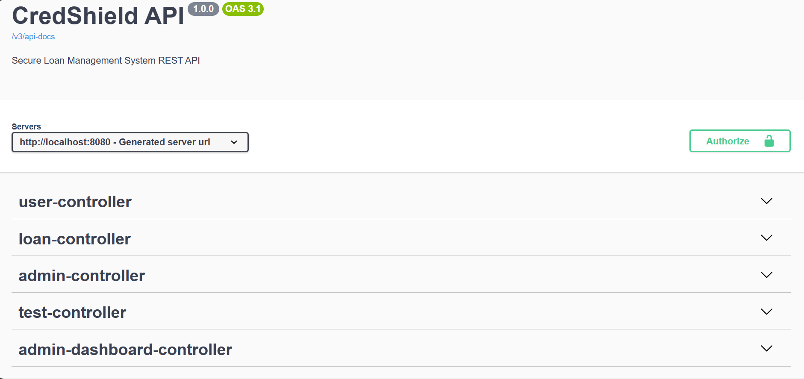
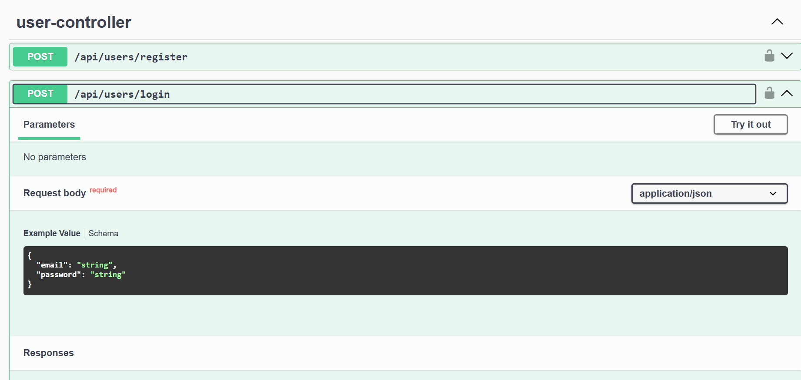
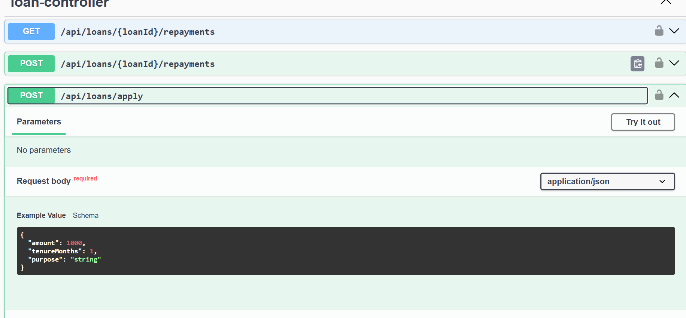
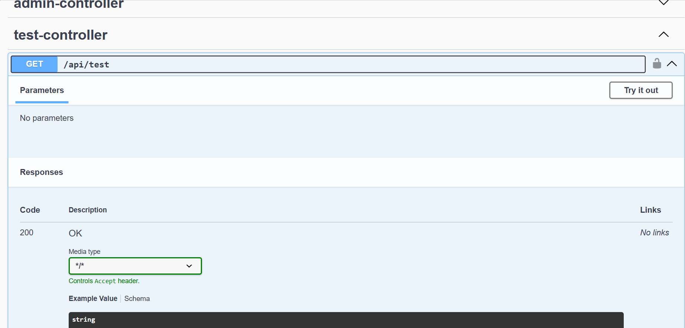
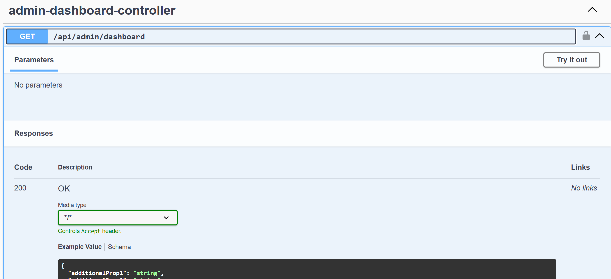
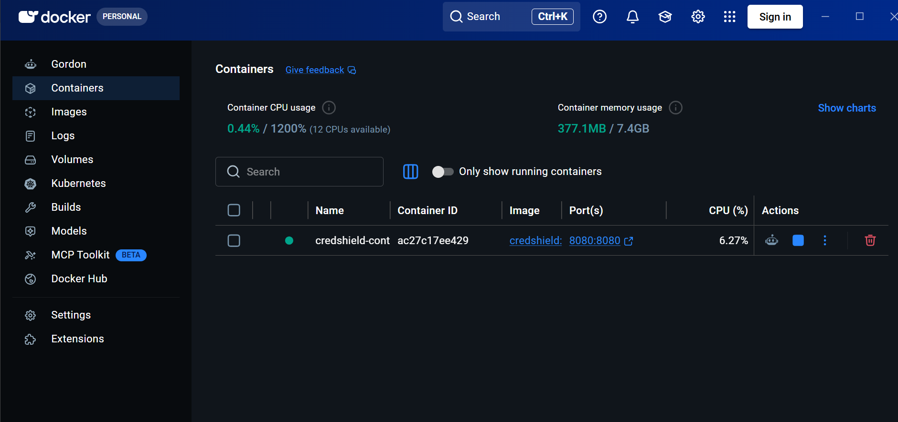

# CredShield – Secure Loan Management System

CredShield is a backend-based loan management system built using Java and Spring Boot. It helps customers apply for loans, track repayments, and view installment schedules. Administrators can manage loan applications and monitor overall loan activity.

## Features

### Authentication and Security
- User registration and login
- Password encryption using BCrypt
- JWT-based authentication
- Role-based authorization (USER and ADMIN)
- Secure REST APIs using Spring Security

### Customer Features
- Apply for loans
- View personal loan history
- Check loan application status
- View EMI installment schedules
- Make loan repayments
- View repayment history and summary

### Admin Features
- View and manage loan applications
- Approve or reject loan applications
- Search, filter, sort, and paginate loan records
- View admin dashboard statistics
- Access audit logs

### Additional Features
- EMI calculator
- Automatic installment generation after loan approval
- Automatic loan closure after all installments are paid
- Global exception handling
- DTO-based API responses
- Application logging
- Swagger API documentation
- Unit testing using JUnit and Mockito
- Docker support

## Technology Stack

| Technology | Purpose |
|---|---|
| Java 21 | Programming language |
| Spring Boot | Backend framework |
| Spring Security | Authentication and authorization |
| Spring Data JPA | Database operations |
| MySQL | Database |
| JWT | Token-based authentication |
| Maven | Build management |
| JUnit 5 | Unit testing |
| Mockito | Mock testing |
| Swagger / OpenAPI | API documentation |
| Docker | Containerization |
| Git & GitHub | Version control |

## Project Structure

```text
credshield/
├── src/
│   ├── main/
│   │   ├── java/com/credshield/credshield/
│   │   │   ├── config/
│   │   │   ├── controller/
│   │   │   ├── dto/
│   │   │   ├── entity/
│   │   │   ├── exception/
│   │   │   ├── repository/
│   │   │   ├── security/
│   │   │   └── service/
│   │   └── resources/
│   └── test/
├── screenshots/
├── Dockerfile
├── .dockerignore
├── .gitignore
├── pom.xml
└── README.md
```

## Getting Started

### Prerequisites

- Java 21
- MySQL 8
- Maven
- Git

### 1. Clone the Repository

```bash
git clone https://github.com/premsangam5/credshield.git
cd credshield
```

### 2. Create the Database

Open MySQL and execute:

```sql
CREATE DATABASE credshield;
```

### 3. Configure Environment Variables

Configure the following environment variables:

```text
DB_URL=jdbc:mysql://localhost:3306/credshield
DB_USERNAME=root
DB_PASSWORD=your_mysql_password
```

Replace `your_mysql_password` with your own MySQL password.

### 4. Run the Application

On Windows PowerShell:

```powershell
$env:DB_URL="jdbc:mysql://localhost:3306/credshield"
$env:DB_USERNAME="root"
$env:DB_PASSWORD="your_mysql_password"

.\mvnw.cmd spring-boot:run
```

### 5. Open Swagger Documentation

After starting the application, visit:

http://localhost:8080/swagger-ui/index.html

## Running Tests

Execute:

```powershell
.\mvnw.cmd test
```

## Docker

Build the Docker image:

```bash
docker build -t credshield:1.0 .
```

Run the application:

```bash
docker run -d --name credshield-container -p 8080:8080 -e DB_URL="jdbc:mysql://host.docker.internal:3306/credshield" -e DB_USERNAME="root" -e DB_PASSWORD="your_mysql_password" credshield:1.0
```

Make sure MySQL is running and accessible from Docker.

## Project Screenshots

### 1. Swagger API Documentation



### 2. User Controller



### 3. Loan Application



### 4. API Test



### 5. Admin Dashboard



### 6. Docker Running



## Security Notes

- Passwords are stored using BCrypt hashing.
- JWT is used for authenticated API access.
- Role-based access control protects administrative endpoints.
- Sensitive database credentials are configured through environment variables.

## Author

**Prem Sangam**

B.Tech – Electronics and Communication Engineering  
Netaji Subhash Engineering College

GitHub: https://github.com/premsangam5
